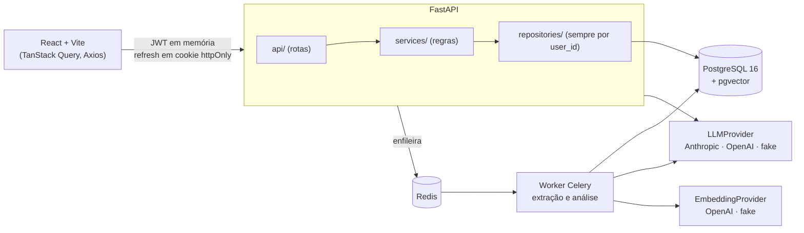

# VagaFit

**Cole uma vaga, escolha seu currículo e veja, requisito por requisito, o que você comprova,
com a frase exata do seu currículo ao lado.** O que não tem evidência aparece como lacuna. O
VagaFit nunca inventa experiência.

## O problema

Quem procura emprego reescreve o mesmo currículo para cada vaga e responde à mão as mesmas
perguntas de triagem. Ferramentas de IA ajudam a escrever, mas costumam "melhorar" o currículo
com coisas que a pessoa nunca fez, e quem paga o preço numa entrevista técnica é o candidato.

O VagaFit faz o caminho oposto. Ele mede a aderência com base só no que está escrito no
currículo, mostra de onde tirou cada conclusão e devolve as lacunas como lacunas.

## Demo

> 🎬 _GIF da demo: em breve._ <!-- TODO: gravar o fluxo seed → análise → triagem → candidatura -->

O fluxo de ponta a ponta:

1. **Currículo:** envie um PDF ou cole o texto. Antes de salvar, dá para conferir como ele foi
   dividido em trechos.
2. **Vaga:** cole o anúncio. O worker extrai cargo, senioridade, modelo de trabalho, stack,
   requisitos obrigatórios e diferenciais.
3. **Análise:** um score de 0 a 100, com cada requisito marcado como *Atende*, *Atende em
   parte* ou *Não atende*. Ao lado de cada veredito vem a citação literal do currículo, e um
   clique abre o trecho completo. Também mostra as lacunas e sugestões de reescrita que só
   reformulam o que já existe.
4. **Triagem:** cole as perguntas do formulário da vaga e receba rascunhos de resposta. Quando
   o currículo não basta para responder, o rascunho vem marcado com **"Precisa da sua
   resposta"** e com a pergunta que você precisa responder.
5. **Candidaturas:** um painel com status (enviada, em análise, teste técnico, entrevista,
   proposta, recusada, sem retorno), plataforma, pretensão e próximo passo.

## Rodando localmente

Você precisa de Docker com Compose e de `make`. Não precisa de chave de API: por padrão, a IA
roda com provedores *fake*, que são determinísticos e não usam rede.

```bash
make up        # api, worker, postgres+pgvector, redis e o front
make migrate   # cria as tabelas
make seed      # conta demo com currículo, vagas e análises fictícias
```

Depois, abra http://localhost:5173 e entre com `demo@vagafit.example` / `demo-vagafit-123`.
Essa conta existe só localmente, os dados são inventados e o seed se recusa a rodar em
produção. A documentação interativa da API fica em http://localhost:8000/docs.

Para usar IA de verdade, copie `.env.example` para `.env` e preencha `LLM_PROVIDER`,
`ANTHROPIC_API_KEY` (ou `OPENAI_API_KEY`) e `EMBEDDING_PROVIDER=openai` com a
`OPENAI_API_KEY`. Se alguma porta estiver ocupada, ajuste `API_PORT`, `WEB_PORT` e
`VITE_API_URL`.

| Comando | O que faz |
|---|---|
| `make up` / `make down` | Sobe e derruba os containers. O volume do banco é mantido. |
| `make migrate` | Aplica as migrações do Alembic. |
| `make seed` | Cria a conta demo (`make seed ARGS=--reset` recria). |
| `make test` | Roda os testes do backend num banco separado, com cobertura mínima de 80%. |
| `make test-unit` | Roda só os testes que não precisam de banco. |
| `make lint` | Roda ruff, mypy strict e o typecheck do front. |
| `make logs` | Acompanha os logs da api e do worker. |

## Arquitetura

O backend é um monólito modular em FastAPI com um worker Celery. As tarefas lentas, como
extrair a vaga e analisar, ficam fora do ciclo da requisição.



Como uma análise acontece:

```mermaid
sequenceDiagram
    participant F as Front
    participant A as API
    participant W as Worker
    participant DB as Postgres/pgvector
    participant L as LLM
    F->>A: POST /analyses {resume_id, job_id}
    A->>DB: já existe análise com o mesmo input_hash?
    alt sim
        A-->>F: 202 com reused: true, sem nova chamada de IA
    else não
        A-->>F: 202 com status pending
        A->>W: run_analysis(id)
        W->>DB: os 3 trechos mais próximos de cada requisito (cosseno)
        W->>L: requisitos + trechos C1..Cn (saída em JSON schema)
        L-->>W: veredito + citação por requisito
        W->>W: valida as citações; se houver erro, uma nova tentativa com o erro no prompt
        W->>DB: result, score e status done
    end
    F->>A: GET /analyses/{id} (a cada 2 s até done ou failed)
```

**Stack:** Python 3.12, FastAPI, Pydantic v2, SQLAlchemy 2 async + asyncpg, Alembic,
PostgreSQL 16 + pgvector, Celery + Redis 7, PyJWT + argon2, structlog,
prometheus-fastapi-instrumentator, React 18, Vite, TypeScript, React Router, TanStack Query,
Axios e Tailwind. Mais detalhes em
[`docs/adr/ADR-001-stack-e-arquitetura.md`](docs/adr/ADR-001-stack-e-arquitetura.md).

## Decisões e porquês

### A regra de honestidade é validada no código, não confiada ao prompt

O prompt pede ao modelo que não invente, mas o que garante isso é o código. Em
`app/services/analysis.py`, toda resposta do LLM passa por um validador antes de ser salva:

- todo *Atende* ou *Atende em parte* precisa de pelo menos uma evidência; sem evidência, o
  veredito tem que ser *Não atende*;
- a evidência aponta para um alias (`C1`, `C2` e assim por diante) de um trecho que **foi
  enviado** ao modelo naquela chamada; trecho inventado é recusado;
- a citação precisa ser **cópia literal** do trecho. A comparação ignora só espaços e
  maiúsculas; o acento conta;
- cada requisito recebe exatamente um veredito, sem repetir nem pular nenhum;
- o `original` de cada sugestão de reescrita também precisa estar literalmente no currículo.

Se a saída não passa, o modelo recebe a lista de erros e tem uma segunda chance. Se falhar de
novo, a análise termina como `failed`, com uma mensagem clara. Uma resposta inválida nunca é
salva. A triagem segue a mesma regra: uma resposta sem evidência só é aceita como
`needs_user_input`, acompanhada da pergunta para o usuário. O front reforça a regra: nunca
mostra *Atende* sem a citação ao lado e marca os textos de triagem como **rascunho**.

### O score sai do código, não do modelo

O modelo dá o veredito de cada requisito e o código faz a conta (`app/services/scoring.py`):
obrigatórios pesam 70% e diferenciais 30%, e *em parte* vale metade. Se a vaga não tem
diferenciais, o peso deles passa para os obrigatórios. As lacunas também são derivadas pelo
código. Assim, a mesma lista de vereditos sempre dá o mesmo score, e dá para testar sem IA.

### O cache não se engana quando o prompt muda

Cada análise grava um `input_hash`, o SHA-256 de currículo, vaga, provedor e modelo do LLM,
modelo de embedding, versão do prompt e k. Pedir de novo o mesmo par devolve o resultado
pronto (`reused: true`), sem gastar chamada de IA. Trocar o modelo ou o prompt muda o hash e
gera uma análise nova. Esse reaproveitamento é medido em `analyses_requested_total{outcome}`.

### RAG com trechos estruturais, não com janela fixa

O currículo é dividido por bloco: uma experiência inteira com empresa, período e bullets, ou
uma seção curta completa, com teto de cerca de 250 tokens. Janelas fixas de 500 tokens
transformariam um currículo de duas páginas em dois ou três pedaços, e a busca perderia o
sentido. A busca é exata por cosseno dentro do próprio currículo. Como são dezenas de trechos
por usuário, um índice aproximado não traz ganho e poderia devolver menos resultados que o
filtro pede.

### Autenticação: access token em memória, refresh rotativo em cookie

O access JWT dura 15 minutos e fica só na memória do front. O refresh dura 7 dias e é guardado
no banco apenas como hash. Ele é trocado a cada uso, e se um refresh já usado reaparece, a
família inteira é revogada. Ele viaja num cookie `HttpOnly; Secure; SameSite=Strict` restrito a
`/api/v1/auth`. O Axios renova o token com uma única requisição, mesmo que várias chamadas
falhem com 401 ao mesmo tempo. A senha usa argon2id, e o login e o cadastro têm rate limit.

### Isolamento entre usuários por construção

Todas as tabelas usam UUID como chave. Todo repository recebe o `user_id` no construtor e não
tem método sem esse filtro. Um recurso de outro usuário responde **404, nunca 403**, para não
confirmar que ele existe. Um teste percorre todas as rotas e falha se alguma aceitar
requisição sem token, e os testes de recurso usam dois usuários para provar o isolamento.

### Provedores atrás de interfaces, e testes sem rede

`LLMProvider` e `EmbeddingProvider` são *protocols*, com implementações para Anthropic, OpenAI
e `fake`. Os provedores `fake` são o padrão no desenvolvimento e nos testes, e o `Settings` os
recusa em produção. Nenhum teste chama API externa, e o retry com backoff tem o `sleep`
injetável para ser testado.

### Logs e métricas sem dado pessoal

Os logs são JSON, gerados pelo structlog. Um processor (`redact_sensitive`) troca por
`[removido]` texto de currículo e de vaga, citações, triagem, e-mail, senha e token, além de
qualquer valor com mais de 200 caracteres. Os logs levam só IDs, contagens e o score. O
`/metrics` (Prometheus) expõe latência e contagem por rota e status, mais os contadores de
negócio: falhas de login, reuso de refresh detectado e análises novas ou reaproveitadas. Nenhum
rótulo carrega ID, e-mail ou texto.

## Endpoints

A base é `/api/v1`. Todo erro segue o formato `{"error": {"code", "message"}}`. O contrato
completo fica em `/docs`.

| Método | Rota | O que faz |
|---|---|---|
| GET | `/health` | Estado da API, do banco e do Redis (fora de `/api/v1`) |
| GET | `/metrics` | Métricas Prometheus (fora de `/api/v1` e do schema) |
| POST | `/auth/register` · `/auth/login` | Criar conta · entrar (rate limit) |
| POST | `/auth/refresh` · `/auth/logout` | Renovar o access token · sair (cookie) |
| GET · DELETE | `/auth/me` | Usuário atual · excluir a conta com tudo dela (exige a senha) |
| GET · POST | `/resumes` | Listar · enviar currículo (PDF ou texto) |
| POST | `/resumes/preview` | Ver a divisão em trechos sem salvar |
| GET · DELETE | `/resumes/{id}` | Detalhar com os trechos · apagar |
| GET · POST | `/jobs` | Listar · cadastrar vaga (a extração roda no worker) |
| GET · DELETE | `/jobs/{id}` | Detalhar com os requisitos extraídos · apagar |
| GET · POST | `/analyses` | Listar (`?job_id=`) · pedir análise (202, com cache por hash) |
| GET | `/analyses/{id}` | Status e resultado |
| GET · POST | `/analyses/{id}/screening` | Listar · gerar rascunhos de triagem |
| GET · POST | `/applications` | Listar (`?status=` com vários valores) · registrar candidatura |
| GET · PATCH · DELETE | `/applications/{id}` | Detalhar · atualizar em parte (`null` limpa o campo) · apagar |

## Testes e qualidade

- **Backend:** pytest com o banco real, Postgres + pgvector, num banco de teste separado. A
  cobertura atual é de cerca de 96%, e o mínimo exigido é 80%. Os testes cobrem fluxos de
  ponta a ponta, isolamento entre dois usuários, a regra de honestidade (citação inventada,
  alias não enviado e veredito sem evidência), o cache, as falhas de IA, o rate limit, a
  redação de log e as métricas.
- **Lint:** ruff (lint e format), mypy `--strict` e `tsc` no front, também no pre-commit.
- **CI:** a cada push, o GitHub Actions roda no backend lint, mypy, migrações e testes com
  Postgres + pgvector, e no front o typecheck e o build.

## Roadmap

- [ ] Identidade visual própria (hoje os tokens de cor e espaçamento são provisórios).
- [ ] GIF da demo e deploy público com cota diária por conta.
- [ ] Testes de componente e e2e no front.
- [ ] Métricas do worker (exporter próprio) e `/metrics` protegido na rede interna.
- [ ] Ler a vaga a partir de uma URL e extensão de navegador.
- [ ] Recuperação de senha e verificação de e-mail.
